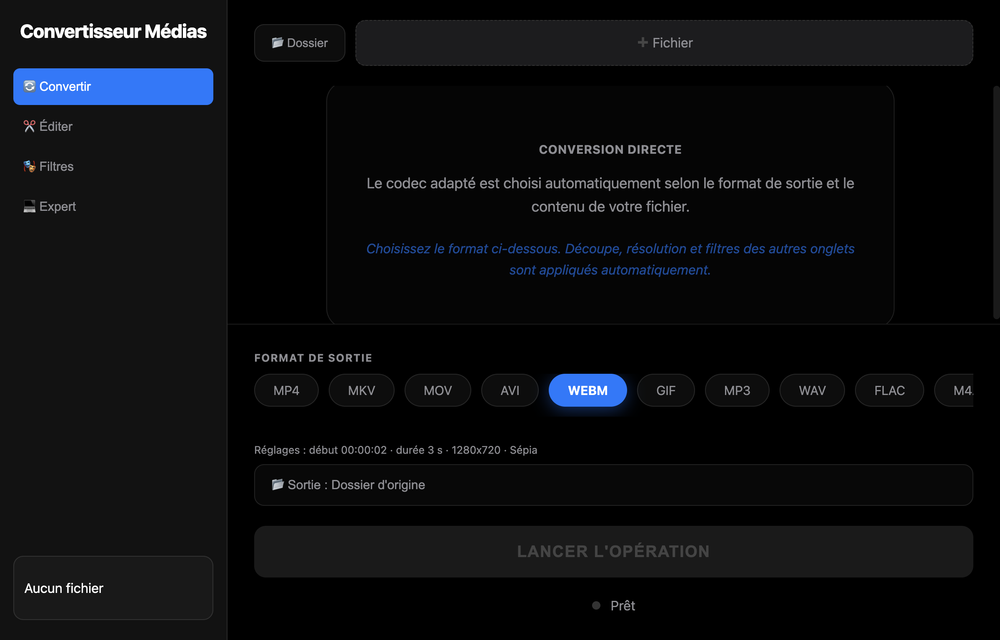

**English** · [Français](README.fr.md)

# Convertisseur Médias (Media Converter)

Audio / video converter for macOS, built on FFmpeg — a single file or a whole folder in one click. The interface is in French.



## Features

- **15 output formats**: MP4, MKV, MOV, AVI, WebM, GIF, TS, FLV, MP3, WAV, FLAC, M4A, OGG, PNG, JPG — the right codec is picked automatically (hardware H.264 via VideoToolbox, VP9/Opus, GIF palette, etc.)
- **Batch conversion**: every media file in a folder and its subfolders (hidden files and previous outputs skipped)
- **Trimming** (start, duration), **resizing** (1080p → 360p, aspect ratio kept) and **filters** (black & white, sepia, blur, brightness), combinable
- **Expert mode**: free FFmpeg arguments, quoting handled for paths with spaces
- File analysis (duration, codec, dimensions) via ffprobe, viewable FFmpeg log

## Compatibility

- **Apple Silicon Macs (M1 to M4) on macOS 15 Sequoia or later** — every Apple Silicon Mac can be upgraded to macOS 15
- **Nothing to install**: no Homebrew, no FFmpeg. FFmpeg and its 91 libraries are bundled in the app
- If the bundled FFmpeg cannot run, the app automatically falls back to Homebrew's (`/opt/homebrew/bin`) or to `/usr/local/bin` if present

The app is not notarised by Apple. On first launch macOS blocks it: open
**System Settings → Privacy & Security** and click **Open Anyway**.

## Architecture

```
src/ffmpeg-args.ts        Builds FFmpeg commands — pure logic, tested
src/ffmpeg-locator.ts     Picks the binary: bundled, else Homebrew / /usr/local
src/index.ts              Electron main process: dialogs, ffprobe, running ffmpeg
src/preload.ts            API exposed to the renderer via contextBridge (contextIsolation, no nodeIntegration)
src/App.tsx               React interface
scripts/bundle-ffmpeg.sh  Makes Homebrew's FFmpeg self-contained for bundling
```

## Development

Requirements: macOS, **Node 22** (see `.nvmrc`) — with Node 26, Electron Forge packaging stops silently and `appdmg`'s native module does not compile.

1. Prepare FFmpeg (not versioned, in `binaries/arm64/`):

```bash
brew install ffmpeg dylibbundler
scripts/bundle-ffmpeg.sh
```

   The script copies `ffmpeg`, `ffprobe` and all their Homebrew libraries, rewrites the paths
   to `@executable_path/libs`, re-signs everything and fails if any Homebrew dependency remains.
   It prints the minimum macOS version of the result (that of the Homebrew bottles).

2. Install and run:

```bash
npm install
npm start
```

## Tests

```bash
npm test                                    # unit tests
FFMPEG_PATH=binaries/arm64/ffmpeg npm test  # + real conversions to the 15 formats
```

## Building the app

```bash
npm run make   # .app, .zip and .dmg in out/
```

## Stack

Electron · React · TypeScript · Webpack · Electron Forge · FFmpeg · Vitest

## Author

**Mamadou Alimou Barry** — [mondobarry.com/en](https://www.mondobarry.com/en/)

## License

GPL v3 — see [LICENSE](LICENSE). FFmpeg, shipped with the app, is built with `--enable-gpl --enable-version3`;
its source code is available on [ffmpeg.org](https://ffmpeg.org). The bundled libraries
(x264, libvpx, Opus, LAME, etc.) keep their respective licenses.
